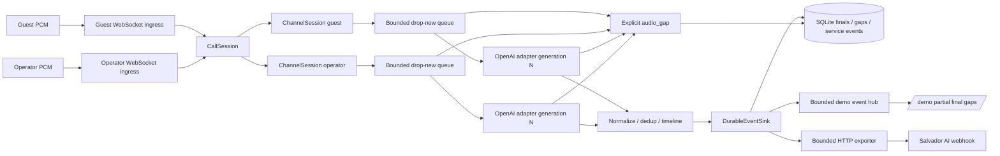

# Архитектура

## Поток компонентов



Ingress только валидирует команды/PCM и вызывает сессию. Адаптер скрывает поля OpenAI. Доменная модель не импортирует SDK и не зависит от транспорта провайдера.

## Изоляция

- `CallRegistry` атомарно создаёт `CallSession` по `call_id`; `hotel_id` неизменен и проверяется при каждом подключении и чтении.
- `CallSession` владеет ровно двумя слотами ролей и per-call `sequence`. Повторное владение активной ролью отклоняется.
- Каждый `ChannelSession` имеет собственные PCM splitter, resampler, аудиотаймлайн, очередь, задачи чтения/отправки, адаптер, VAD/item state, `utterance_id` и `connection_generation`.
- Аудио и события разных звонков не разделяют изменяемые очереди или счётчики реплик. Одновременная речь разрешена; сетевой порядок финалов не считается хронологией.

## Event lifecycle

1. Адаптер выдаёт provider-neutral partial/final с revision и аудиограницами.
2. `ChannelSession` отображает provider timeline на исходный call timeline, отбрасывает старые revision/generation и повторные финалы.
3. Partial обновляет один `utterance_id` и `sequence`, увеличивая внутреннюю `revision`. Partial уходит подписчикам, но не становится строкой финальной транскрипции.
4. `DurableEventSink` атомарно сохраняет первый непустой или пустой финал в SQLite. Повтор по `(call_id, utterance_id)` подавляется; конфликтующий повтор не перезаписывает первый финал.
5. Только созданный финал публикуется локальным подписчикам и ставится в exporter. Пустой финал не экспортируется как реплика.
6. Чтение SQLite сортирует финалы по `start_ms`, `sequence`, `utterance_id`.

`occurred_at` — wall-clock диагностика события. `start_ms/end_ms` — аудиотаймлайн, а не время сетевого получения.

## SQLite и exporter

SQLite содержит звонки, финальные реплики, gaps и service events. Один worker сериализует операции через ограниченную очередь; WAL, foreign keys и уникальный `(call_id, utterance_id)` обеспечивают локальную идемпотентность. Partial в базу не пишется.

HTTP exporter получает финал после сохранения. Он использует timeout, конечные retry с backoff/jitter и стабильный `Idempotency-Key`. Это at-least-once, не exactly-once. При overflow/failure запись остаётся в SQLite с терминальным `export_status`. Durable outbox с автоматическим recovery после перезапуска пока отсутствует.

## Bounded queues и drop-new

- Аудиоочередь каждого канала ограничена числом кадров. `put_nowait` при переполнении отбрасывает **новый** кадр, сохраняя порядок уже принятых.
- Последовательные потери аккумулируются в `audio_gap` с причиной, известными границами, dropped frames/bytes и метрикой.
- Очереди SQLite, HTTP export и demo-подписчиков также ограничены. Demo hub применяет drop-new к медленному зрителю, не блокируя аудиотракт.
- Медленный Salvador webhook не ждёт в цикле приёма аудио. Сохранённый финал важнее временной недоступности внешнего приёмника.

## Reconnect, generations и gaps

Ошибка чтения/отправки или завершение provider stream переводит только затронутый канал в `reconnecting`. Незавершённый partial старого поколения аннулируется; уже сохранённые финалы неизменны. Старый адаптер закрывается, выполняются ограниченные попытки подключения с backoff/jitter.

После успеха увеличивается `connection_generation`, создаются новые provider item/utterance state и новый reader. Поздние события старого поколения отбрасываются. Аудио, которое нельзя принять или передать, получает `openai_disconnect`, `reconnect_timeout` или `queue_overflow` gap; неизвестные границы остаются `null`, а не выдумываются. Исчерпание попыток делает failed только один канал.

Для контролируемого live-разрыва существует отдельный demo-only hook, закрывающий именно OpenAI WebSocket. Он требует одновременно backend `openai` и `SALVADOR_DEMO_PROVIDER_FAULTS_ENABLED=true`; по умолчанию маршрут возвращает 404.

## Latency

Валидная формула:

```text
final_latency_ms = t_final_internal_monotonic - t_speech_end_ingress_monotonic
```

- `t_speech_end_ingress_monotonic` берётся из ingress-сообщения, содержащего подтверждённый VAD `audio_end_ms` после отображения на call timeline.
- `t_final_internal_monotonic` фиксируется после нормализации и публикации в `DurableEventSink`, то есть после сохранения финала.
- Точность начала ограничена гранулярностью PCM-кадра/WebSocket-сообщения и корректностью provider VAD.
- Если VAD не подтвердил конец речи либо bounded history уже не содержит соответствующий ingress timing, измерение получает `unavailable` с причиной. Conservative `end_ms`, длительность файла и конец отправки не используются как замена.
- Bounded collector хранит сырые наблюдения без текста. Агрегаты: count/min/median/nearest-rank p95/max и доля `<= 2000 мс`. Reconnect исключается из normal-статистики.

## Shutdown

Stop запрещает новое аудио, дренирует ограниченный остаток, делает flush resampler и `finish_input`, ждёт доступные финалы в пределах дедлайна и закрывает оба адаптера. Повторный stop идемпотентен; `call_completed` публикуется не более одного раза. При timeout незавершённый partial получает gap, а не превращается в финал. Lifespan приложения закрывает все звонки, затем дренирует exporter с отдельным дедлайном и закрывает SQLite.

## Границы масштабирования

Архитектура поддерживает несколько независимых звонков в процессе, но реестр, event hub и очереди являются in-process. Для нескольких worker/instance потребуются распределённый реестр или sticky routing, внешний event transport, durable outbox и политика владения SQLite/внешней БД. Нагрузочная ёмкость и 4000 номеров не подтверждены: нужны пиковая concurrency, длительность звонков, сетевой профиль и отдельные нагрузочные испытания.
