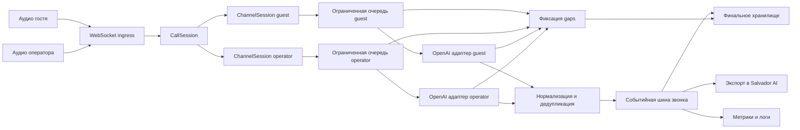

# Salvador Transcriber — план реализации

## 1. Результат и границы работ

### 1.1. Ожидаемый результат

Самостоятельный асинхронный Python-сервис, который:

- принимает два независимых аудиоканала звонка по WebSocket: guest и operator;
- создаёт для каждого канала отдельную сессию транскрибации OpenAI Realtime API;
- передаёт аудио потоково, получает промежуточные и окончательные тексты, учитывает VAD;
- публикует нормализованные события с привязкой к звонку, гостинице, роли и аудиотаймлайну;
- не смешивает каналы и разговоры, подавляет повторные финальные события;
- ограничивает буферы, восстанавливает соединения и явно сообщает о потерянном аудио;
- сохраняет только финальную транскрипцию и служебные gaps отдельно от partial;
- передаёт финальные реплики в Salvador AI через изолированный интеграционный интерфейс;
- предоставляет метрики, структурированные логи, локальную демонстрацию и измеренные результаты испытаний.

Исходные требования: [`plans/techincal-task.md`](techincal-task.md). Детальные испытания вынесены в [`plans/test-plan.md`](test-plan.md).

### 1.2. Входит в scope

- FastAPI/WebSocket ingress для уже оцифрованного аудио двух участников.
- Внутренние контракты событий, состояния звонка и каналов.
- PCM-валидация, ресэмплинг и учёт аудиотаймлайна.
- Реальный адаптер OpenAI Realtime API и fake-адаптер только для автотестов.
- Partial/final, VAD, дедупликация, хронология, backpressure, reconnect, gaps.
- Локальное хранение финальной транскрипции и HTTP-интерфейс экспорта.
- Метрики, graceful shutdown, автотесты, демонстрация двух звонков, отчёты.

### 1.3. Не входит в scope

- Телефония, SIP, Asterisk, маршрутизация и получение аудио из телефонной сети.
- Браузерный кабинет, CRM, PMS, RAG, карточки гостей, анализ контекста и суфлёр.
- Дополнительные ИИ-провайдеры и определение говорящего в смешанном потоке.
- Production-развёртывание, Kubernetes, балансировщики, HA и нагрузочное доказательство для комплекса на 4000 номеров.
- Гарантия exactly-once через внешний HTTP: внутри сервиса финал фиксируется один раз, а внешняя доставка выполняется с повторами и идемпотентным ключом.

## 2. Минимальная архитектура

### 2.1. Границы компонентов

| Компонент | Единственная ответственность | Не должен делать |
|---|---|---|
| FastAPI/WebSocket ingress | Проверить start/stop и формат, связать соединение с call_id, hotel_id и ролью, передать PCM в существующую сессию | Обращаться к OpenAI, хранить реплики, менять порядок событий |
| CallSession | Владеть двумя каналами, общим контекстом, счётчиками, шиной событий и завершением звонка | Смешивать аудио или выполнять сетевые вызовы OpenAI |
| ChannelSession | Конечный автомат одного канала, очередь, аудиотаймлайн, reconnect и жизненный цикл одного адаптера | Управлять другим каналом или другим звонком |
| OpenAI adapter | Скрыть транспорт и проверенные поля Realtime API, отправить аудио, вернуть сырые события и ошибки | Определять бизнес-правила дедупликации и хранения |
| Audio pipeline | Проверить PCM, ресэмплировать без смешивания каналов, считать длительность и смещения | Интерпретировать текст |
| Normalizer | Преобразовать события адаптера во внутренние partial/final/error, создать стабильные внутренние идентификаторы | Зависеть от конкретных JSON-полей OpenAI вне адаптера |
| Finalizer и dedup | Подавить повторы, зафиксировать финал не более одного раза, закрыть незавершённые partial при gap | Повторно распознавать текст или склеивать неполные реплики |
| Event bus | Передать нормализованные события подписчикам через ограниченные очереди | Блокировать приём аудио на медленном HTTP |
| Repository | Атомарно сохранить финал, gap и состояние звонка; читать полную транскрипцию | Хранить partial как часть финальной транскрипции |
| Salvador exporter | Отправить финальные события по HTTP с таймаутом, retry и idempotency key | Генерировать подсказки или вызывать RAG/CRM |
| Observability | Метрики и логи с контекстом, измерение задержек и восстановления | Логировать ключи, аудио или текст по умолчанию |
| Shutdown coordinator | Остановить приём, ограниченно дренировать очереди, завершить каналы и освободить ресурсы | Бесконечно ждать OpenAI или экспорт |

### 2.2. Изоляция и многозвоночность

- Реестр звонков индексируется по call_id; hotel_id фиксируется при создании и сверяется при подключении второго канала. Несовпадение отклоняется.
- Каждый CallSession владеет ровно двумя слотами ролей. Повторное подключение той же роли обрабатывается по явной политике: заменить старый ingress только после его закрытия либо отклонить; одновременное владение одним слотом запрещено.
- Каждый ChannelSession имеет собственные очередь, задачи, OpenAI WebSocket, VAD-состояние, счётчик реплик и generation соединения.
- Никаких глобальных изменяемых очередей аудио, глобальных utterance_id или общего VAD-состояния.
- Реестр и хранилище не ограничивают архитектуру одним звонком. Горизонтальное масштабирование и распределённый реестр — последующее улучшение, а не часть демонстрации.

### 2.3. Предлагаемый ingress-контракт

Это собственный контракт сервиса, а не поля OpenAI API:

- отдельное WebSocket-подключение на канал по маршруту, содержащему call_id и role;
- первое текстовое start-сообщение содержит hotel_id и описание входного PCM: encoding, sample_rate, channels, frame duration;
- далее передаются бинарные PCM-фреймы; текстовые stop и ping являются управляющими;
- ответы ingress содержат accepted, ready, warning, gap и terminal error; транскрипция передаётся через общий выходной интерфейс, а не смешивается с подтверждениями приёма;
- неизвестная роль, несовпадение hotel_id, неподдерживаемый формат, нечётное число байтов PCM16 и сообщения до start отклоняются с понятным кодом;
- размер сообщения и частота кадров ограничиваются конфигурацией.

Такой вариант не требует base64, сохраняет бинарный аудиопоток эффективным и делает владельца канала однозначным. Если реальный Salvador AI уже задаёт другой транспорт, изменение ограничивается ingress-адаптером.

## 3. Контракты и инварианты

### 3.1. Событие транскрипции

Общий конверт содержит:

| Поле | Правило |
|---|---|
| event_id | Уникальный идентификатор конкретного издания события |
| event_type | transcript_partial, transcript_final, audio_gap, call_completed или channel_status |
| call_id, hotel_id | Неизменный контекст звонка |
| utterance_id | Стабилен для всех partial и финала одной реплики; уникален внутри call_id |
| role | Только guest или operator |
| sequence | Общий монотонный номер реплики внутри звонка, выделяется при создании реплики и не меняется при обновлениях |
| revision | Монотонный номер обновления partial; финал завершает цепочку |
| text | Текущий текст partial или неизменяемый финальный текст |
| is_final | Различает промежуточное и окончательное событие |
| start_ms, end_ms | Смещения на единой аудиотаймлинии звонка; для partial end_ms может уточняться |
| connection_generation | Позволяет отбросить поздние события закрытого OpenAI-соединения |
| occurred_at | Время формирования внутреннего события для диагностики, не заменяет аудиотаймлайн |

Дополнительные правила:

- utterance_id формируется внутри сервиса из роли и счётчика канала, а не зависит от необязательных идентификаторов провайдера.
- sequence не используется как доказательство отсутствия перекрытия: одновременная речь разрешена.
- Хронология восстанавливается сортировкой финалов по start_ms, затем sequence и utterance_id. Порядок сетевого получения финалов хронологией не считается.
- Финал имеет непустой нормализованный текст, если только провайдер явно не вернул пустую реплику; пустые финалы не экспортируются как реплики, но учитываются в метриках.
- Повторный partial с небольшей revision игнорируется; событие старого generation игнорируется.
- Повторный финал с тем же utterance_id не создаёт новую запись и новый экспорт. Конфликт двух разных финалов логируется как ошибка целостности; первый принятый финал остаётся авторитетным.

### 3.2. События для Salvador AI

- Для гостя финал преобразуется в guest_utterance_completed.
- Для оператора используется operator_utterance_completed.
- Полезная нагрузка содержит исходные call_id, hotel_id, utterance_id, role, sequence, text, start_ms и end_ms.
- Idempotency key строится от call_id, utterance_id и типа финального события.
- audio_gap и call_completed передаются через тот же интерфейс, если принимающая сторона подтвердит их поддержку; независимо от этого они сохраняются локально и попадают в отчёт.
- HTTP-адаптер имеет таймаут, ограниченное число повторов с backoff и jitter. Очередь экспорта ограничена; переполнение не приводит к потере сохранённого финала и явно сигнализируется.

### 3.3. Gap как данные, а не только лог

Gap содержит call_id, hotel_id, role, начало и конец на аудиотаймлинии, если они известны, причину, generation, число отброшенных кадров и байт. Допустимые причины: queue_overflow, openai_disconnect, reconnect_timeout, invalid_inflight_utterance, shutdown_timeout.

- При переполнении по умолчанию отбрасываются новые аудиокадры, а не старые: уже принятый порядок не переписывается.
- Последовательные потери объединяются в один расширяемый gap; после возобновления приёма gap закрывается и сохраняется.
- При обрыве незавершённый partial старого generation аннулируется. Поздний финал старого соединения не склеивается с новой репликой.
- Уже сохранённые финалы не изменяются. После reconnect создаётся новый generation и новые utterance_id.
- Если границы потери нельзя точно определить, неизвестность отмечается явно; выдуманные временные метки запрещены.

## 4. Последовательные этапы и подпланы

Каждый этап завершается проверяемым результатом. Зависимости указаны по номерам.

### Этап 1. Каркас, конфигурация и проверка внешних предположений — P0

**Зависимости:** доступ к официальной документации OpenAI; для реального запуска — тестовый ключ.

**Задачи:**

1. Создать Python-проект, зависимости, entry point FastAPI, настройки через переменные окружения и пример конфигурации без секретов.
2. Задать типизированные настройки лимитов очередей, PCM, VAD, reconnect, таймаутов, SQLite и HTTP-экспорта; проверять недопустимые значения при старте.
3. Добавить health/readiness endpoints и базовое структурированное логирование.
4. По актуальной официальной документации зафиксировать отдельный checklist: доступность и точное имя модели gpt-live-transcribe, WebSocket URL, аутентификацию, поддерживаемые аудиоформаты и частоты, события отправки аудио, настройки VAD, завершение ввода, типы partial/final/error и семантику закрытия.
5. Все неподтверждённые имена полей оставить только в адаптере за слоем проверки; не распространять их на доменную модель.

**Результат:** запускаемый пустой сервис, валидируемая конфигурация и документ проверенных параметров OpenAI.

**Критерии готовности:** сервис стартует без ключа в fake-режиме; реальный режим без ключа падает с понятной ошибкой; секреты не попадают в логи; каждый используемый параметр Realtime API имеет ссылку на официальную документацию и дату проверки.

### Этап 2. Внутренние контракты событий и fake-адаптер — P0

**Зависимости:** этап 1.

**Задачи:**

1. Описать типы событий, состояния звонка/канала и ошибки без полей конкретного провайдера.
2. Зафиксировать инварианты идентификаторов, revision, sequence, аудиотаймлайна и gap из раздела 3.
3. Определить асинхронный интерфейс адаптера: подключение, отправка PCM, поток событий, завершение ввода и закрытие.
4. Реализовать сценарный fake только для тестов: partial, финал, дубли, события вне порядка, задержку, разрыв и восстановление.
5. Описать JSON-схемы внешнего события и ошибки валидации.

**Результат:** стабильный внутренний контракт, на который независимо опираются ingress, OpenAI-адаптер, хранилище и экспорт.

**Критерии готовности:** схемы round-trip валидны; fake воспроизводит все ошибки без сети; доменные события не импортируют SDK OpenAI.

### Этап 3. Жизненный цикл звонка и независимых каналов — P0

**Зависимости:** этапы 1–2.

**Задачи:**

1. Реализовать реестр CallSession и атомарное создание/получение звонка.
2. Реализовать состояния звонка: created, active, closing, closed, failed; и канала: connecting, ready, degraded, reconnecting, closing, closed, failed.
3. Подключить ingress к двум ChannelSession, проверить владельца роли и неизменность hotel_id.
4. Выделить задачи приёма, отправки аудио и чтения событий; исключить ожидание одного канала в цикле другого.
5. Реализовать идемпотентное закрытие CallSession и удаление из реестра после освобождения ресурсов.

**Результат:** два независимых fake-канала на звонок и несколько звонков в одном процессе.

**Критерии готовности:** одновременные кадры не блокируют другой канал; повторный stop безопасен; чужой hotel_id и конфликт роли отклоняются; после закрытия не остаётся задач и соединений.

### Этап 4. Аудиоформат, ресэмплинг и таймлайн — P0

**Зависимости:** этапы 1–3; подтверждённые требования OpenAI к аудио.

**Задачи:**

1. Принять на входе PCM16 little-endian mono; явно валидировать частоту, выравнивание кадров и размер.
2. Разбить поток на фиксированные кадры, сохраняя остаток между WebSocket-сообщениями.
3. Добавить stateful-ресэмплинг в частоту, требуемую подтверждённой конфигурацией OpenAI; не использовать неподдерживаемые предположения о модели.
4. Вести start_ms/end_ms по числу исходных аудиосэмплов от начала звонка, а не по времени прихода сетевых событий.
5. Сохранить отображение границ речи на исходный таймлайн после ресэмплинга; корректно выполнить flush при завершении.
6. Проверить 8/16/48 kHz как минимальный набор входных fixtures, если эти частоты заявлены ingress; неподдерживаемые частоты отклонять.

**Результат:** валидный PCM для адаптера и устойчивые временные метки без накопления дробного смещения.

**Критерии готовности:** длительность после ресэмплинга соответствует входу в пределах одного выходного сэмпла/документированной точности; каналы не смешиваются; границы кадров и финальный остаток обработаны; тесты длительной паузы не показывают дрейф таймлайна.

### Этап 5. Реальное подключение OpenAI — P0

**Зависимости:** этапы 1–4, тестовый ключ и подтверждённая документация.

**Задачи:**

1. Реализовать реальный адаптер поверх официального SDK либо документированного WebSocket-транспорта; выбор зафиксировать после проверки поддержки нужного режима.
2. Создать одно соединение на канал, передать подтверждённые модель, аудио и VAD-параметры.
3. Потоково отправлять кадры без ожидания завершения всей реплики и параллельно читать события.
4. Преобразовать сырые ответы в нейтральные события адаптера, сохраняя provider event/item identifiers только если они реально документированы.
5. Обработать ошибки аутентификации, ограничения скорости, сетевой разрыв и закрытие без исключения на уровне всего приложения.
6. Реализовать документированное завершение ввода и закрытие соединения.

**Результат:** реальная двухканальная транскрибация хотя бы одного разговора.

**Критерии готовности:** получены реальные partial и final для обеих ролей; fake не используется в этой проверке; ключ не попадает в репозиторий/логи; точные payload-поля соответствуют checklist этапа 1.

### Этап 6. Partial/final и VAD — P0

**Зависимости:** этапы 2–5.

**Задачи:**

1. Сопоставить документированные события провайдера созданию и обновлению внутренней реплики.
2. Обновлять один utterance_id для partial и завершать его одним финалом.
3. Настроить VAD через конфигурацию, включая чувствительность и длительность тишины только теми полями, которые подтверждены документацией.
4. Подобрать стартовые значения на реальных записях с короткой паузой; не разбивать фразу без необходимости и не задерживать финал чрезмерно.
5. Обработать финал без предшествующего partial, пустой partial, повторный финал и событие после закрытия канала.
6. Если провайдер не даёт нужных границ речи, вычислять их из локального VAD/аудиотаймлайна либо явно фиксировать ограничение точности.

**Результат:** единый поток partial/final с корректными границами и настройками VAD.

**Критерии готовности:** обычная фраза завершается один раз; короткая пауза обрабатывается согласно конфигурации; одновременная речь остаётся в разных каналах; все реплики имеют проверяемые временные метки.

### Этап 7. Идемпотентность, хронология, хранение и экспорт — P0

**Зависимости:** этапы 2, 3 и 6.

**Задачи:**

1. Ввести per-call выделение sequence и per-channel выделение utterance_id под короткой синхронизацией без сетевых вызовов.
2. Отбрасывать устаревшие revision, старые generation и повторные финалы.
3. Создать SQLite-схему для звонков, финальных реплик, gaps и статуса экспорта; включить уникальное ограничение по call_id и utterance_id.
4. Сохранять финал атомарно и идемпотентно до публикации во внешний экспорт; partial в финальную транскрипцию не записывать.
5. Реализовать чтение полной транскрипции в хронологическом порядке с детерминированным tie-breaker.
6. Реализовать EventSink и HTTP-экспорт guest/operator с таймаутом, retry и idempotency key; для локальной демонстрации добавить NDJSON/HTTP-приёмник.
7. При недоступности экспорта сохранить финал локально, сообщить о неотправленных событиях и не блокировать аудиотракт.

**Результат:** финальная транскрипция сохраняется отдельно, а Salvador AI получает структурированные события.

**Критерии готовности:** повторная обработка одного финала даёт одну строку и одно внутреннее финальное событие; чтение возвращает стабильную хронологию; HTTP-повтор использует тот же ключ; оба типа реплик экспортируются.

### Этап 8. Backpressure, reconnect и явные gaps — P0

**Зависимости:** этапы 3–7.

**Задачи:**

1. Ограничить очереди аудио, исходящих событий и экспорта; настроить размеры по числу кадров/событий и предельному времени буферизации.
2. Использовать неблокирующую постановку в аудиоочередь; при переполнении применять drop-new, метрику и gap.
3. Обнаруживать разрыв через чтение, ошибку отправки и таймаут; переводить только затронутый канал в reconnecting.
4. Выполнять ограниченные попытки reconnect с экспоненциальным backoff, jitter и отменой при shutdown.
5. На время reconnect сохранять только ограниченный объём нового аудио; переполнение фиксировать как потерю.
6. Инвалидировать незавершённые реплики старого generation, сохранить прежние финалы и возобновить распознавание новым generation.
7. При исчерпании попыток закрыть канал с terminal error, не завершая автоматически второй канал и весь процесс.

**Результат:** ограниченная память и предсказуемая деградация при задержках/обрывах OpenAI.

**Критерии готовности:** очередь не растёт выше лимита; каждая потеря имеет gap и метрику; reconnect не смешивает поколения; после восстановления появляются новые финалы; второй канал и другой звонок продолжают работать.

### Этап 9. Graceful shutdown и финализация ровно один раз — P0

**Зависимости:** этапы 3, 5–8.

**Задачи:**

1. Различить stop звонка, закрытие ingress, отказ канала и остановку приложения.
2. На stop прекратить приём нового аудио, дренировать ограниченный остаток, выполнить документированное завершение ввода и дождаться финалов в пределах дедлайна.
3. Закрыть оба канала независимо от ошибки одного; отменить reconnect и фоновые задачи.
4. Незавершённые partial после дедлайна аннулировать с gap, а не выдавать за финальные.
5. Сделать финализацию реплики и звонка идемпотентной; call_completed публиковать не более одного раза.
6. Дренировать экспорт в пределах отдельного дедлайна; остаток явно отметить как неотправленный.
7. На остановке приложения запретить новые звонки и применить тот же координатор ко всем активным сессиям.

**Результат:** повторяемое завершение без зависших задач, потери уже доступных финалов и повторных записей.

**Критерии готовности:** повторный stop и shutdown не меняют транскрипцию; оба OpenAI-соединения закрыты; финал сохранён не более одного раза; превышение дедлайна видно в логах, метриках и gaps.

### Этап 10. Наблюдаемость — P0

**Зависимости:** базовые события этапов 3–9.

**Задачи:**

1. Добавить Prometheus-метрики активных звонков/каналов, состояний, глубины очередей, принятых/отброшенных кадров, partial/final, дублей, ошибок, reconnect и экспорта.
2. Добавить гистограммы задержки финала, времени reconnect, обработки кадра и HTTP-экспорта без меток с высокой кардинальностью.
3. Вести structured logs с call_id, hotel_id, role, utterance_id и generation в контексте, но не как labels Prometheus.
4. Добавить health/readiness: реальный режим не готов без валидной конфигурации; состояние отдельных звонков не должно раскрывать текст.
5. Отключить логирование аудио и текста по умолчанию; предусмотреть явную безопасную диагностическую опцию без секретов.

**Результат:** техническое состояние и деградации наблюдаемы без доступа к содержимому разговора.

**Критерии готовности:** все пять сценариев оставляют машиночитаемые метрики; разрыв, дубль, overflow и gap различимы; labels не содержат call_id/hotel_id/utterance_id; чувствительные данные отсутствуют в стандартных логах.

### Этап 11. Автотесты — P0

**Зависимости:** соответствующие этапы 2–10; полный набор после их завершения.

**Задачи:**

1. Покрыть unit-тестами контракты, ресэмплинг, таймлайн, конечные автоматы, дедупликацию, сортировку и ограниченные очереди.
2. Покрыть integration-тестами FastAPI + fake-адаптер + SQLite + тестовый HTTP-приёмник.
3. Автоматизировать пять сценариев ТЗ на fake для быстрой регрессии, не выдавая их за проверку реального OpenAI.
4. Добавить отдельные тесты дублей, overflow, изоляции call_id/hotel_id, финализации ровно один раз, хронологии, сохранения финалов и фиксации потери аудио.
5. Проверять отсутствие незавершённых задач и корректное закрытие ресурсов после каждого сценария.

**Результат:** быстрый повторяемый набор тестов без сети и отдельно маркированные реальные интеграционные проверки.

**Критерии готовности:** тесты детерминированы, не зависят от реального ключа и проходят повторно; сетевые тесты имеют явный маркер и не запускаются в быстром наборе. Полная матрица — [`plans/test-plan.md`](test-plan.md).

### Этап 12. Демонстрация, документация и измерения — P0

**Зависимости:** этапы 5–11.

**Задачи:**

1. Подготовить локальный двухканальный demo-client, подающий аудио в реальном темпе, и простой вывод partial/final/gap.
2. Подготовить сценарий двух одновременных звонков с разными call_id и hotel_id.
3. Написать инструкцию установки, настройки ключа, запуска, конфигурации VAD/лимитов и повторения испытаний.
4. Описать архитектуру, события, семантику доставки, gaps, хранение и ограничения MVP.
5. Выполнить обязательные реальные проверки всех пяти сценариев и сохранить результаты, версии конфигурации и сбои.
6. Измерить задержки и восстановление по разделу 6; не подменять измерения утверждением о целевых двух секундах.

**Результат:** воспроизводимая демонстрация и комплект сдачи с фактическими результатами.

**Критерии готовности:** другой исполнитель может запустить сервис и тесты по инструкции; реальная двухсторонняя транскрибация показана; отчёт содержит сырые измерения и невыполненные пункты с причинами.

## 5. Порядок выполнения в ограничении одного рабочего дня

Точные часовые оценки не задаются. Приоритет — быстро получить реальный сквозной тракт, затем усилить надёжность, не жертвуя обязательной проверкой OpenAI.

### 5.1. MVP / P0 — обязательный вертикальный срез

1. Этапы 1–2: каркас, контракты и проверка документации.
2. Этапы 3–4: два канала и корректный PCM.
3. Этап 5: как можно раньше подключить настоящий OpenAI и подтвердить partial/final.
4. Этапы 6–7: финализация, дедупликация, SQLite и минимальный HTTP-экспорт.
5. Этапы 8–10: ограничения очередей, reconnect/gaps, shutdown и минимально достаточные метрики.
6. Этапы 11–12: автоматическая регрессия, реальные пять сценариев, два звонка, отчёт и документация.

Если возникает дефицит времени, сокращаются вспомогательный интерфейс и дополнительные оптимизации, но не реальный OpenAI, разделение каналов, ограниченные буферы, сохранение финалов, gaps, тесты изоляции и честный отчёт.

### 5.2. P1 — только после выполнения P0

- Durable outbox с фоновой повторной отправкой после перезапуска процесса.
- Более точная калибровка VAD на расширенном корпусе акцентов, шума и пауз.
- Расширенные аудиоfixtures, контроль качества ресэмплинга и нагрузочные профили очередей.
- Более богатый demo UI, replay сохранённых сценариев и визуализация таймлайна.
- Дополнительные alert-правила, tracing и exemplars.
- Нагрузочное тестирование большего числа одновременных звонков и настройка лимитов по профилю памяти.

### 5.3. Явно за рамками текущей итерации

- Распределённые очереди, sticky routing, внешний реестр сессий и автоматическое горизонтальное масштабирование.
- Production security hardening, HA, deployment и эксплуатационные runbooks.
- Телефония, CRM, RAG, суфлёр, PMS и дополнительные модели.
- Доказательство производительности для 4000 номеров без данных о числе одновременных разговоров.

## 6. Измерение задержки и восстановления

### 6.1. End-to-end задержка финальной реплики

Основная метрика: **final_latency_ms = t_final_internal − t_speech_end_ingress**.

- t_speech_end_ingress — monotonic timestamp момента, когда последний аудиосэмпл завершённой речи принят ingress. Он связывается с аудиотаймлайном и документированной VAD-границей; нельзя использовать время получения финала OpenAI как начало измерения.
- t_final_internal — monotonic timestamp момента, когда нормализованный финал прошёл дедупликацию и атомарно сохранён/поставлен во внутреннюю шину.
- Дополнительно измеряются t_export_sent и t_export_ack для отдельной сетевой задержки Salvador AI; она не скрывается внутри основной метрики.
- Все серверные точки используют одни monotonic clock. Wall clock сохраняется только для сопоставления отчёта.
- Аудио подаётся в реальном темпе. Ускоренная подача fixtures непригодна для end-to-end задержки и используется только в функциональных тестах.
- Для каждого измерения сохраняются scenario, role, длительность речи, VAD-конфигурация, reconnect flag, final_latency_ms и export_latency_ms без обязательного сохранения текста.

### 6.2. Критерии отчёта по задержкам

- Отдельно отчитываться по guest и operator, по обычному разговору/одновременной речи/паузам и по совокупной нормальной сети.
- Для нормальных сценариев собрать не менее 20 финалов на роль, если объём предоставленных записей позволяет; при меньшем числе явно указать фактический размер выборки.
- Указать count, min, median, p95, max, долю финалов до 2000 мс и число исключённых измерений с причиной.
- Целевой критерий MVP: p95 не более 2000 мс при нормальном соединении. Если цель не достигнута, сдать фактические значения, конфигурацию VAD и узкое место; не исключать медленные валидные наблюдения.
- Reconnect-сценарии не включать в статистику нормальной сети.

### 6.3. Критерии отчёта по восстановлению

Для каждого обрыва фиксировать:

- t_disconnect и способ искусственного разрыва;
- t_detected, t_reconnect_started, t_ready и t_first_new_final;
- detection_delay, reconnect_duration и время до первой новой финальной реплики;
- число попыток, ошибки, dropped frames/bytes и оценённую длительность потерянного аудио;
- идентификаторы сохранённых финалов до разрыва, gap и первой реплики после восстановления.

Проверка считается успешной, если процесс и второй канал не падают, прежние финалы сохранены, reconnect завершился в пределах настроенного бюджета попыток, новая речь распознана, а любая потеря представлена gap. Фактические значения публикуются даже при неуспехе.

## 7. Definition of Done

MVP считается готовым только при выполнении всех пунктов:

- [ ] Реальный OpenAI Realtime API используется для обеих ролей; fake применяется только в автотестах.
- [ ] Название gpt-live-transcribe и все точные параметры API проверены по актуальной официальной документации; неподтверждённые предположения отсутствуют.
- [ ] Guest и operator имеют независимые ChannelSession и OpenAI-соединения; одновременная речь не смешивается.
- [ ] Partial обновляют одну реплику; логический финал создаётся и сохраняется не более одного раза, а HTTP-повторы экспорта используют тот же idempotency key.
- [ ] Все финалы имеют call_id, hotel_id, utterance_id, role, sequence, start_ms и end_ms; хронология детерминированно восстанавливается.
- [ ] Полная финальная транскрипция хранится отдельно от partial и доступна после завершения звонка.
- [ ] guest_utterance_completed и событие оператора передаются через документированный интерфейс с idempotency key.
- [ ] Очереди ограничены; overflow и разрывы создают метрики и явные gaps; память не растёт бесконечно.
- [ ] Reconnect восстанавливает затронутый канал без остановки приложения и без изменения старых финалов.
- [ ] Stop и shutdown идемпотентны, дренируют доступные результаты с дедлайном и освобождают оба канала.
- [ ] Быстрые автотесты и обязательные реальные проверки пяти сценариев выполнены; два независимых разговора продемонстрированы.
- [ ] Метрики и логи показывают ошибки, разрывы, дубли, overflow, состояния и задержки без утечки секретов.
- [ ] Отчёт содержит измеренные latency/recovery, конфигурацию, выборку, сбои и невыполненные требования с техническим продолжением.
- [ ] Локальный запуск и демонстрация воспроизводятся по документации.

## 8. Артефакты сдачи

1. Исходный код и lock-файл зависимостей в Git-репозитории.
2. Реальный OpenAI-адаптер и checklist сверки API в [`docs/openai-verification.md`](../docs/openai-verification.md).
3. Инструкция запуска в [`README.md`](../README.md) и безопасный пример конфигурации.
4. Краткая архитектура и контракты в [`docs/architecture.md`](../docs/architecture.md) и [`docs/events.md`](../docs/events.md).
5. Автоматические тесты и сценарный fake-адаптер.
6. Demo-client, аудиоfixtures с указанием происхождения и команды воспроизведения.
7. SQLite-база демонстрационного прогона либо экспорт финальной транскрипции без чувствительных данных.
8. Заполненный [`docs/test-report.md`](../docs/test-report.md) с пятью реальными сценариями, задержками, reconnect и gaps.
9. Список известных ограничений и невыполненных пунктов с причиной и предлагаемым решением.

## 9. Риски и открытые вопросы

| Риск или вопрос | Влияние | Решение по умолчанию |
|---|---|---|
| gpt-live-transcribe может оказаться недоступным или называться иначе | Блокирует реальный адаптер | Проверить в первом этапе; использовать только документированное доступное имя и явно зафиксировать отклонение от предпочтительной модели |
| Точные поля Realtime API, VAD и завершения ввода могут отличаться от предположений | Риск неработающего payload | Изолировать протокол в адаптере; не писать доменную логику на непроверенных полях |
| Неизвестны фактические PCM-параметры браузера Salvador AI | Возможна несовместимость ingress | P0: PCM16 mono с явной частотой; согласовать реальный источник и добавить только необходимый ресэмплинг |
| Неизвестны endpoint, auth и схема Salvador AI | Нельзя подтвердить настоящую приёмку интеграции | P0: конфигурируемый HTTP webhook и локальный приёмник; перед сдачей запросить спецификацию и выполнить контрактную проверку при доступе |
| Провайдер может не дать точные границы речи | Снижает точность start_ms/end_ms и latency | Связать VAD-границы с локальным аудиотаймлайном; ограничение точности указать в отчёте |
| Reconnect может дублировать незавершённую реплику | Риск повторного финала | Старый generation закрывается; in-flight partial аннулируется с gap; поздние события отбрасываются |
| Потеря аудио не всегда имеет точные границы | Нельзя честно восстановить полный текст | Сохранять известные границы и неизвестность; не склеивать текст через разрыв |
| Внешний HTTP не поддерживает exactly-once | Повторная доставка при retry | At-least-once + стабильный idempotency key; требование дедупликации на приёмнике согласовать |
| Сетевая задержка и квоты тестового ключа | Цель 2 секунды может не выполняться | Измерять отдельно, сохранять ошибки и конфигурацию; не выдавать сетевые условия за гарантию |
| 4000 номеров не равно числу одновременных звонков | Невозможно обосновать capacity target | Для будущего планирования запросить пиковую concurrency, длительность и аудиопрофиль; в MVP доказать только два звонка |
| Настоящие записи могут содержать персональные данные | Риск утечки | Использовать разрешённые fixtures, не логировать текст/аудио по умолчанию, не коммитить базу и ключи |

Открытые вопросы, не блокирующие начало: подтверждённый ingress-формат, спецификация webhook Salvador AI, требования к retention SQLite, допустимые VAD-дефолты на реальных разговорах и целевое число одновременных звонков после MVP.

## 10. Предлагаемая структура проекта

Структура разделяет владение файлами, чтобы последующие Code-подзадачи выполнялись независимо через внутренние контракты.

### Корень и конфигурация

- [`pyproject.toml`](../pyproject.toml) — зависимости, entry points, pytest/lint/type-check настройки.
- [`README.md`](../README.md) — установка, запуск, демонстрация и команды тестов.
- [`.env.example`](../.env.example) — все настройки без реальных секретов.
- [`src/salvador_transcriber/main.py`](../src/salvador_transcriber/main.py) — сборка приложения и lifespan.
- [`src/salvador_transcriber/config.py`](../src/salvador_transcriber/config.py) — типизированная конфигурация и валидация.

### API и доменные контракты

- [`src/salvador_transcriber/api/routes.py`](../src/salvador_transcriber/api/routes.py) — WebSocket, health и transcript endpoints.
- [`src/salvador_transcriber/api/schemas.py`](../src/salvador_transcriber/api/schemas.py) — ingress start/stop/error и внешние схемы.
- [`src/salvador_transcriber/domain/events.py`](../src/salvador_transcriber/domain/events.py) — partial/final/gap/status и инварианты.
- [`src/salvador_transcriber/domain/state.py`](../src/salvador_transcriber/domain/state.py) — состояния звонка и канала.

### Сессии и аудио

- [`src/salvador_transcriber/sessions/registry.py`](../src/salvador_transcriber/sessions/registry.py) — изолированный реестр звонков.
- [`src/salvador_transcriber/sessions/call_session.py`](../src/salvador_transcriber/sessions/call_session.py) — владение каналами, sequence и завершение.
- [`src/salvador_transcriber/sessions/channel_session.py`](../src/salvador_transcriber/sessions/channel_session.py) — очередь, generation, reconnect и задачи канала.
- [`src/salvador_transcriber/audio/pcm.py`](../src/salvador_transcriber/audio/pcm.py) — PCM-валидация, кадры и аудиотаймлайн.
- [`src/salvador_transcriber/audio/resampler.py`](../src/salvador_transcriber/audio/resampler.py) — stateful-ресэмплинг и flush.

### OpenAI и обработка событий

- [`src/salvador_transcriber/transcription/adapter.py`](../src/salvador_transcriber/transcription/adapter.py) — нейтральный асинхронный интерфейс адаптера.
- [`src/salvador_transcriber/transcription/openai_realtime.py`](../src/salvador_transcriber/transcription/openai_realtime.py) — реальный транспорт и только проверенные API-поля.
- [`src/salvador_transcriber/transcription/normalizer.py`](../src/salvador_transcriber/transcription/normalizer.py) — перевод событий адаптера во внутренние.
- [`src/salvador_transcriber/transcription/finalizer.py`](../src/salvador_transcriber/transcription/finalizer.py) — revision, dedup, generation и финал ровно один раз.
- [`src/salvador_transcriber/transcription/ordering.py`](../src/salvador_transcriber/transcription/ordering.py) — детерминированная хронология.

### Надёжность, хранение и интеграция

- [`src/salvador_transcriber/runtime/queues.py`](../src/salvador_transcriber/runtime/queues.py) — ограниченные очереди и drop-new policy.
- [`src/salvador_transcriber/runtime/shutdown.py`](../src/salvador_transcriber/runtime/shutdown.py) — координатор stop/shutdown и дедлайны.
- [`src/salvador_transcriber/storage/repository.py`](../src/salvador_transcriber/storage/repository.py) — интерфейс хранения.
- [`src/salvador_transcriber/storage/sqlite.py`](../src/salvador_transcriber/storage/sqlite.py) — схема, атомарный финал, gaps и чтение транскрипции.
- [`src/salvador_transcriber/export/sink.py`](../src/salvador_transcriber/export/sink.py) — интерфейс экспорта и типы событий Salvador AI.
- [`src/salvador_transcriber/export/http.py`](../src/salvador_transcriber/export/http.py) — HTTP timeout/retry/idempotency.
- [`src/salvador_transcriber/observability/metrics.py`](../src/salvador_transcriber/observability/metrics.py) — Prometheus-метрики и latency observations.
- [`src/salvador_transcriber/observability/logging.py`](../src/salvador_transcriber/observability/logging.py) — structured context и redaction.

### Тесты, демонстрация и документы

- [`tests/fakes/openai.py`](../tests/fakes/openai.py) — сценарный fake без сети.
- [`tests/unit/`](../tests/unit/) — контракты, аудио, состояния, dedup, ordering, queues.
- [`tests/integration/`](../tests/integration/) — FastAPI, два канала, SQLite, export, reconnect и shutdown.
- [`tests/real/`](../tests/real/) — явно маркированные сценарии с настоящим OpenAI.
- [`tests/fixtures/`](../tests/fixtures/) — разрешённые PCM/аудио и манифест ожидаемых границ.
- [`scripts/demo.py`](../scripts/demo.py) — двухканальная и двухзвоночная демонстрация в реальном темпе.
- [`scripts/measure_latency.py`](../scripts/measure_latency.py) — сбор сырых измерений и агрегатов.
- [`docs/openai-verification.md`](../docs/openai-verification.md) — дата, ссылки и подтверждённые параметры API.
- [`docs/architecture.md`](../docs/architecture.md) — краткая архитектура и решения.
- [`docs/events.md`](../docs/events.md) — события, хронология, gaps и доставка.
- [`docs/test-report.md`](../docs/test-report.md) — фактические результаты испытаний.

## 11. Независимое распределение последующих Code-подзадач

После этапа 2 контракты замораживаются, и работы распределяются так:

- Исполнитель API владеет каталогом API и использует интерфейс реестра, не меняя OpenAI-адаптер.
- Исполнитель аудио владеет PCM/ресэмплингом и тестами fixtures.
- Исполнитель OpenAI владеет реальным адаптером и verification-документом.
- Исполнитель сессий владеет CallSession/ChannelSession, reconnect и shutdown.
- Исполнитель хранения владеет SQLite и ordering-запросами.
- Исполнитель интеграции владеет EventSink/HTTP и тестовым приёмником.
- Исполнитель качества владеет fake, тестовой матрицей, demo и измерениями.

Изменения общих событий выполняются только согласованно, поскольку они являются границей всех подзадач. Приоритет слияния: контракты → аудио/адаптер → сессии → хранение/экспорт → наблюдаемость → демонстрация и отчёты.
